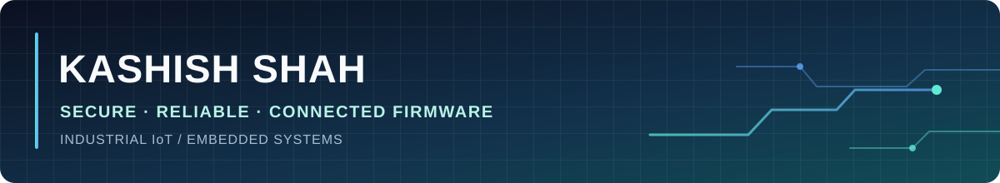

# Hi, I'm Kashish 👋

**Embedded Software Engineer | Wireless IoT · RTOS · Firmware Reliability & Security**

I build firmware for connected devices that need to do more than work on a development board. They need to **connect reliably, operate on limited power, survive unexpected failures, and remain maintainable long after deployment**.

I'm a Software Engineer II at **Digi International**, with **5+ years of experience** developing production embedded software for industrial IoT and wireless systems. My work sits at the intersection of microcontrollers, real-time software, wireless protocols, and hardware-level debugging.

> Boot cleanly. Connect reliably. Sleep deeply. Stay secure. Recover gracefully.

## 📡 What I Work On

- **Wireless IoT & connectivity:** I contribute to production firmware spanning LoRaWAN, BLE, Amazon Sidewalk, Zigbee, IEEE 802.15.4, DigiMesh, Wi-SUN, and Sub-GHz systems. My deepest experience is in LoRaWAN, including XBee host communication through AT commands and API frames.
- **Firmware updates & recovery:** Two-stage bootloaders, XMODEM-based updates, image validation, version compatibility, backup/restore, watchdogs, and recovery paths for field-deployed devices.
- **Low-power & reliable systems:** MCU sleep-state optimization, peripheral power management, battery-operated sensing, and root-cause analysis of brownouts and intermittent field failures.
- **RTOS & modular design:** FreeRTOS task scheduling, queues and synchronization, plus hardware and network abstractions that reduce application dependencies on specific wireless modules.
- **Validation & debugging:** Automated unit and functional testing, fault reproduction, and hands-on debugging with oscilloscopes, logic analyzers, and JTAG/SWD tools.

## 🧰 Technical Toolbox

| Area | Technologies |
| --- | --- |
| **Languages** | C, C++, Python, Bash, ARM Assembly |
| **MCUs & platforms** | ARM Cortex-M, STM32, EFR32, nRF54, ESP32 |
| **Operating systems** | FreeRTOS |
| **Wireless** | LoRaWAN, BLE, Amazon Sidewalk, Zigbee, IEEE 802.15.4, Wi-SUN, DigiMesh, Sub-GHz |
| **Interfaces** | UART, SPI, I²C, ADC, Modbus RTU, XMODEM |
| **Testing & tools** | Pytest, Unity, Ceedling, Git, CI/CD, JTAG/SWD, oscilloscopes, logic analyzers |

## 🔭 What I'm Exploring

- **Zephyr RTOS & portable architectures:** Deepening my understanding of Zephyr, device abstraction, and modular firmware that can adapt across hardware platforms and wireless technologies.
- **Edge AI:** Exploring TinyML, Edge Impulse, and TensorFlow Lite for useful on-device intelligence in resource-constrained systems.
- **Embedded Linux:** Building a stronger bridge between microcontroller firmware and Linux-based edge systems.
- **Firmware security:** Exploring secure boot, cryptographic firmware authentication, image integrity, secure update strategies, and rollback protection.
- **IoT lifecycle development:** Looking beyond deployment to device provisioning, trust establishment, diagnostics, updates, recovery, long-term maintenance, and eventual retirement.

## 🎓 Background

- **M.S. in Electrical Engineering** | The University of Texas at Arlington
- **B.E. in Electronics** | University of Mumbai

## 📬 Contact

- **Email:** [kashishshah2510@gmail.com](mailto:kashishshah2510@gmail.com)
- **LinkedIn:** [linkedin.com/in/kashishshah25](https://www.linkedin.com/in/kashishshah25)
- **GitHub:** [github.com/kashish55991](https://github.com/kashish55991)

